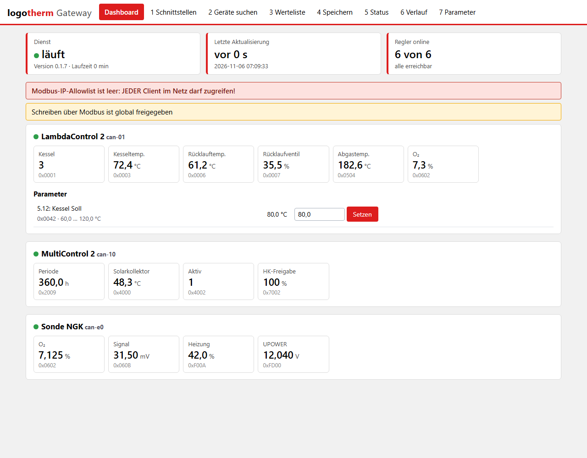
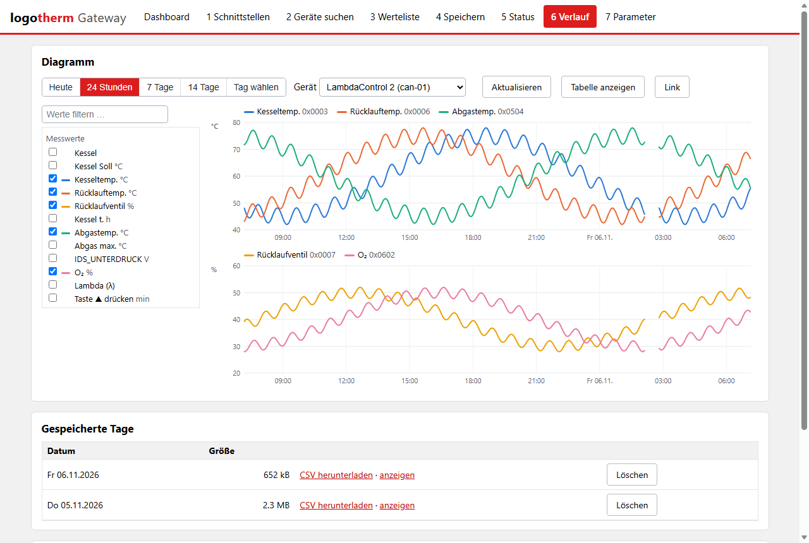
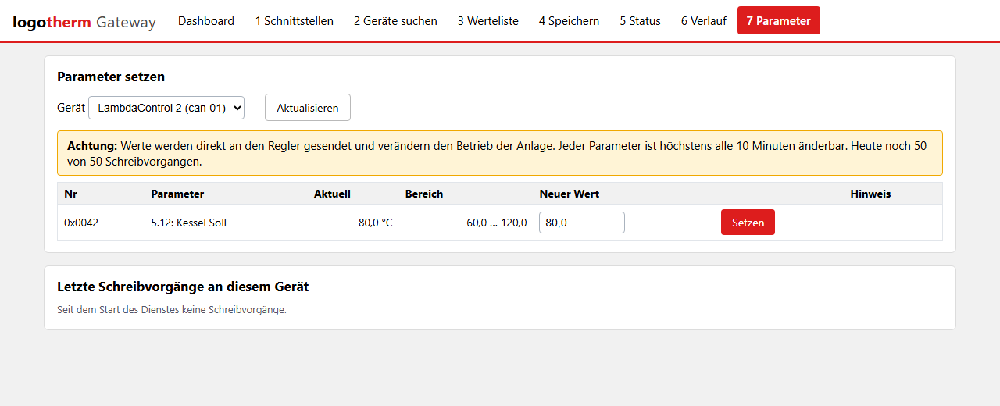

# Logotherm Modbus-Gateway

Stellt Messwerte und Parameter von **Logotherm-Heizungsreglern** per **Modbus TCP** bereit – für
Leittechnik, SPS, Home Assistant & Co. Mit Weboberfläche, Dashboard, Aufzeichnung und Diagrammen.

> **Privates Projekt, kein offizielles Logotherm-Produkt.** Nutzung auf eigene Verantwortung, nur
> privat und nicht-kommerziell, ohne Gewähr und ohne Haftung – siehe [LICENSE](LICENSE).



## Was es kann

- **Regler:** über CAN (LambdaControl 2, MultiControl 2, LambdaControl 1 BSB, Erweiterungen,
  Zündung, WRS-D, O2-Sonde) mit dem USB-CAN-Adapter *InnoMaker USB2CAN*, und über RS232
  (LambdaControl 1) mit einem FTDI-USB-Seriell-Adapter.
- **Modbus TCP:** je Regler eine Unit-ID; Messwerte als Float32 (FC 04), Parameter (FC 03/16),
  Status je Wert, Gerätestatus, Diagnose-Unit 247. Registerliste als CSV.
- **Weboberfläche:** Geräte suchen, Werte auswählen, Dashboard, Verlauf mit Diagrammen,
  Parameter setzen – am PC und vom Smartphone im lokalen Netz (mit Passwort).
- **Aufzeichnung:** alle Werte (Standard alle 60 s, 14 Tage), tageweise löschbar, CSV-Export.
- **Sicherheit:** Schreiben ist ab Werk aus. Nur freigegebene Parameter, Sperrliste für kritische
  Parameter, Min/Max, höchstens alle 10 Minuten je Parameter, Tagesbudget, Rückmeldung des Reglers.
- **Windows-Dienst** mit Installer, Statusfenster (Launcher) und automatischer Update-Prüfung;
  alternativ **Docker** (Linux, SocketCAN).

| Verlauf | Parameter setzen |
|---|---|
|  |  |

## Installation (Windows)

1. Unter [**Releases**](../../releases/latest) `LogothermGateway-Setup-<Version>.exe` herunterladen.
2. Als Administrator ausführen. Empfohlen: Aufgaben *WinUSB-Treiber* und *Weboberfläche im
   Netzwerk freigeben* angehakt lassen.
3. Launcher (Startmenü *Logotherm Gateway (Status)*) → *Einrichtung öffnen* → Passwort setzen,
   CAN aktivieren, Geräte suchen, Werte auswählen, speichern.

Voraussetzungen: Windows 10/11 64 Bit (x64). Ausführlich: [docs/windows.md](docs/windows.md).
Updates meldet der Launcher selbst.

## Docker (Linux)

Siehe [docs/docker.md](docs/docker.md) – Start mit `docker compose up -d --build` im Ordner `docker/`.

## Selbst bauen

```powershell
# Entwicklung / Tests (Python 3.12)
py -3.12 -m venv .venv
.venv\Scripts\python -m pip install -r requirements.lock
.venv\Scripts\python -m pip install -e . --no-deps
.venv\Scripts\python -m pytest

# Ausprobieren ohne Hardware (Simulator)
.venv\Scripts\gateway -c docs\gateway.example.yaml run --simulate

# Windows-Installer (nur Docker Desktop nötig, Linux-Container)
powershell -ExecutionPolicy Bypass -File packaging\windows\build-docker.ps1
```

Der Installer entsteht unter `release/`. Details: [docs/windows.md](docs/windows.md), Abschnitt
„Installer selbst bauen“.

## Fragen & Kontakt

Fragen, Fehler und Ideen bitte als [**Issue**](../../issues) melden – mit Version (Launcher bzw.
`gateway.exe --version`), Reglertyp und den passenden Zeilen aus
`C:\ProgramData\LogothermGateway\logs\gateway.log`. So helfen Antworten auch anderen.
Was nicht öffentlich sein soll: **helfen.52vamp@icloud.com**.
Es gibt keinen garantierten Support (privates Projekt).

## Lizenz

Frei für private, nicht-kommerzielle Nutzung. Keine Gewähr, keine Haftung – weder durch den Autor
noch durch die Logotherm Regelsysteme GmbH. Vollständiger Text: [LICENSE](LICENSE).
Änderungen je Version: [CHANGELOG.md](CHANGELOG.md).
